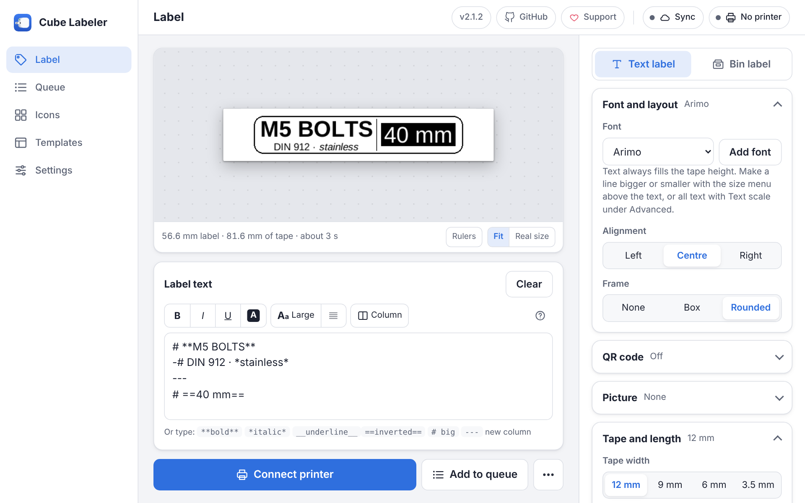
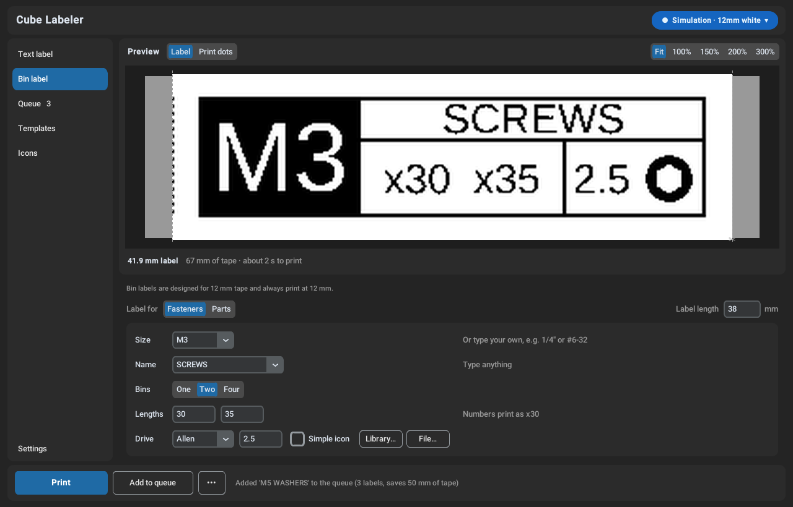

# Cube Labeler

[](https://github.com/McTobe/printlabel-ui/actions/workflows/tests.yml)
[](https://github.com/McTobe/printlabel-ui/releases/latest)


[](LICENSE)

A desktop app for designing and printing labels on the **Brother P-touch Cube (PT-P300BT)** over Bluetooth. It shows an exact preview of the printed tape, prints several labels as one strip to save tape, and has a dedicated editor for storage bin labels.

Cube Labeler runs on Windows as a single portable `.exe`, with no Python install needed. It also has a command-line mode for printing from scripts.



## Features

- **Live preview.** See the label on a simulated tape cartridge in its real colors, or switch to *Print dots* to see exactly what the print head will print. Label length, tape used and print time are shown as you type.
- **Less tape waste.** Queue several labels and print them as one continuous strip with cut guides between them. Every label, queued or not, starts with a dotted cut line in place of the printer's own ":" cut mark. Each extra label saves about 25 mm of tape.
- **Bin labels.** A dedicated editor for fastener and parts bins: size block, name, one, two or four length boxes and a drive icon (Allen, Hex, PH, PZ, Torx, Slot), in English or Swedish.
- **Text, QR codes and images.** Any installed or imported font, auto-fit to the tape height, alignment and outline. Mix sizes per line, use bold, italic, underlined or inverted (white on black) text, align single lines, split the label into columns with a divider, and add a box or rounded frame. Add QR codes (including Wi-Fi guest login codes), icons or your own pictures.
- **Icon library.** Monochrome icons for fasteners, screw drives, mechanical parts, electronics, wiring, tools, home & kitchen and safety marks, plus your own icons in `~/.printlabel/icons/`. Browse and manage them on the **Icons** page.
- **Icon editor.** Import or paste any picture and tune how it turns into black and white (drawing, filled silhouette or photo outline, cutoff, line thickness, crop, clean-up) with a live dot-for-dot print preview, then touch it up with a pencil and eraser. Your icons keep their original picture, so you can edit them again later.
- **Backups.** Export your icons, saved templates and settings to one `.cubebackup` file and restore all or part of it on another PC, or turn on automatic backups to a folder that Google Drive, OneDrive or Dropbox syncs (the newest 10 are kept). API keys are left out. Open **Backups…** on the Icons page or in Settings; older `.cubeicons` backups still restore.
- **Templates.** Ready-made starting points (storage box, cable flag, Wi-Fi QR, spice jar, asset tag, name badge) and your own templates, saved in the app under **My templates** (template JSON files can still be opened).
- **Printer status.** Battery level, loaded tape width and color, and clear messages for errors such as an open cover or missing tape.
- **Simulation mode.** Design and "print" labels with no printer connected.
- **Optional AI icons.** Have Google Gemini, OpenAI or OpenRouter redraw a photo or picture as a printable icon, with ready-made presets (filled silhouette like the built-in icons, bold line drawing, flat symbol, clean up and keep the shape) or your own instructions, then finish it in the icon editor (needs your own API key for the service, chosen under Settings).
- **Export.** Save any label as a high-resolution PNG.



## Supported hardware

| | |
|---|---|
| **Printer** | Brother P-touch Cube **PT-P300BT**, connected over Bluetooth (serial port) |
| **Tape** | Brother TZe tape, 3.5 mm, 6 mm, 9 mm and 12 mm wide. Bin labels use 12 mm tape. |
| **Computer** | 64-bit Windows 10 or 11 with Bluetooth |

Other Brother models are not tested. The printing code and the CLI also run on macOS and Linux, but the app is built and tested for Windows.

## Installation

1. Download `CubeLabeler.exe` from the [latest release](https://github.com/McTobe/printlabel-ui/releases/latest).
2. Put it anywhere you like and double-click it. There is nothing to install.

Windows SmartScreen may warn you the first time because the file is not code-signed. Choose **More info**, then **Run anyway**.

## Connecting the printer

1. Turn the printer on. The power LED turns green.
2. In Windows, open **Settings → Bluetooth & devices → Add device**, choose **Bluetooth** and pick **PT-P300BT**. Windows creates a serial (COM) port for it.
3. In Cube Labeler, click the **printer chip** at the top right. Turn **Simulation** off, choose **Scan ports** and select the printer's port (for example `COM3`).
4. Choose **Check status**. The chip shows the model, loaded tape and battery when the printer is ready.

## Usage

The window has a **left rail** for switching views, the **tape preview** in the middle and the **printer chip** at the top right.

| View | What it's for |
|---|---|
| **Text label** | Type text under the preview. Font, QR code, icon, length and advanced options are in the panel on the right. |
| **Bin label** | Labels for fastener or parts bins. Pick *Fasteners* or *Parts* under *Label for*; fields are listed in the order they appear on the label. |
| **Queue** | Labels added with **Add to queue** print as one strip. Reorder, edit or remove them before printing. |
| **Templates** | Ready-made labels and your own saved templates. |
| **Icons** | The icon library: browse, search, import, make, edit and back up icons. |
| **Settings** | Bin label language, AI service (Gemini, OpenAI or OpenRouter) with its API key and model, backups and simulation mode. |

### Styling label text

Select text and use the buttons above the editor (**B**, *I*, U, *Inverted*, *Line size*, *Line align*, *Add column*), or type the markers yourself. They are plain text, so templates, the queue and the web version keep them.

| Type | Result |
|---|---|
| `**bold**`, `*italic*`, `__underline__`, `==inverted==` | Styles inside a line (`Ctrl+B`, `Ctrl+I`, `Ctrl+U`) |
| `# `, `## `, `-# ` at the start of a line | Large, medium or small line |
| `<< `, `>< `, `>> ` at the start of a line | Left, centred or right line, whatever the label's alignment |
| `---` on its own line | Starts a new column with a divider line |
| `\*` | A plain `*` (works for any marker) |

Fonts without their own bold or italic file get a drawn one. The **Frame** option in the *Text* section puts a box or rounded frame around the label.

The preview can show the whole label (**Fit**) or zoom to 100–300%, where long labels scroll sideways. The **•••** menu next to **Print** has *Export PNG* and *Feed tape*.

### Keyboard shortcuts

| Shortcut | Action |
|---|---|
| `Ctrl+P` | Print |
| `Ctrl+Enter` | Add to queue |
| `Ctrl+S` | Export PNG |
| `Ctrl+B`, `Ctrl+I`, `Ctrl+U` | Bold, italic, underline in the label text |
| `Esc` | Close the printer panel |

### Command line

Run `CubeLabeler.exe` with arguments to use it without the window:

```powershell
CubeLabeler.exe --ports                       # list serial ports and find the printer
CubeLabeler.exe COM4 --status                 # battery, tape and errors
CubeLabeler.exe COM4 "Storage Box #42"        # print a label
CubeLabeler.exe COM4 "Line one\nLine two"     # two-line label
CubeLabeler.exe COM4 --feed                   # feed 25 mm of tape
CubeLabeler.exe --virtual "Test" --preview --save-png test.png  # no printer needed
```

`CubeLabeler.exe --help` lists every option, including `--font`, `--font-size`, `--width`, `--image`, `--no-cut-guide` and `--auto-cut`.

## Building from source

You need Python 3.10 or newer (releases are built with 3.11).

```powershell
git clone https://github.com/McTobe/printlabel-ui.git
cd printlabel-ui
pip install -r requirements.txt -c constraints.txt
python main.py          # or double-click run.bat
```

To build the portable executable, install PyInstaller and run the build script. The result is `dist\CubeLabeler.exe`.

```powershell
pip install pyinstaller -c constraints.txt
python build.py         # or double-click build.bat
```

### Web version (preview)

`web/` holds a browser version that prints over Bluetooth from Chrome on Android, Windows, macOS and Linux. Double-click `run_web.bat` (or run `python web/serve.py`) to start it; it prints the address to open on your phone. To host it, GitHub Actions publishes a Docker image (`ghcr.io/mctobe/cube-labeler-web`) that serves it on port 80 for a reverse proxy that adds HTTPS. See [web/README.md](web/README.md).

Pushing a tag such as `v1.4.0` builds the executable on GitHub Actions and publishes it as a release.

### Running the tests

```bash
python -m unittest discover tests
```

The tests run on Windows and Linux in CI. On machines without tkinter the GUI tests are skipped.

### Project layout

| Folder | Contents |
|---|---|
| `core/` | Printer protocol and status, serial driver and simulator, label and bin label rendering, fonts, icons, config, CLI |
| `ui/` | The customtkinter app: main window, preview, editors, printer chip, templates, settings, dialogs |
| `assets/` | App icon, icon library (`assets/icons/catalog.json` lists categories, titles and search words) and template previews |
| `icons-src/` | SVG drawings of the library icons; `python tools/build_icons.py` renders them to `assets/icons/` (needs `pip install resvg-py`) |
| `tests/` | Unit tests and headless GUI tests |

## Contributing

Bug reports and ideas are welcome in [Issues](https://github.com/McTobe/printlabel-ui/issues). For a pull request, keep changes focused, add or update tests where it makes sense, and check that `python -m unittest discover tests` passes.

## Credits

Cube Labeler started as a GUI for `printlabel` from [Ircama/PT-P300BT](https://github.com/Ircama/PT-P300BT), and its printer protocol code is based on that project. Built with [customtkinter](https://github.com/TomSchimansky/CustomTkinter), [Pillow](https://python-pillow.org/), [pyserial](https://github.com/pyserial/pyserial) and [qrcode](https://github.com/lincolnloop/python-qrcode).

Brother and P-touch are trademarks of Brother Industries, Ltd. This project is not affiliated with or endorsed by Brother.

## License

Cube Labeler is released under the [MIT License](LICENSE), except `core/ptcbp.py` and `core/ptstatus.py`. Those two files are based on [Ircama/PT-P300BT](https://github.com/Ircama/PT-P300BT), which doesn't state a license, so they are not covered by MIT. See [LICENSE](LICENSE) for details.
