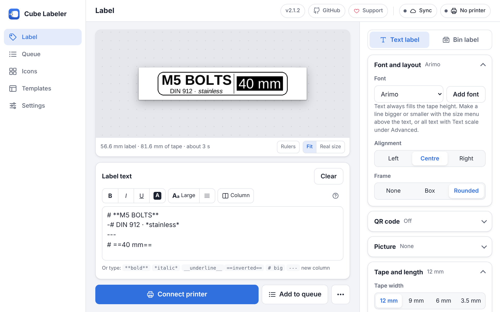
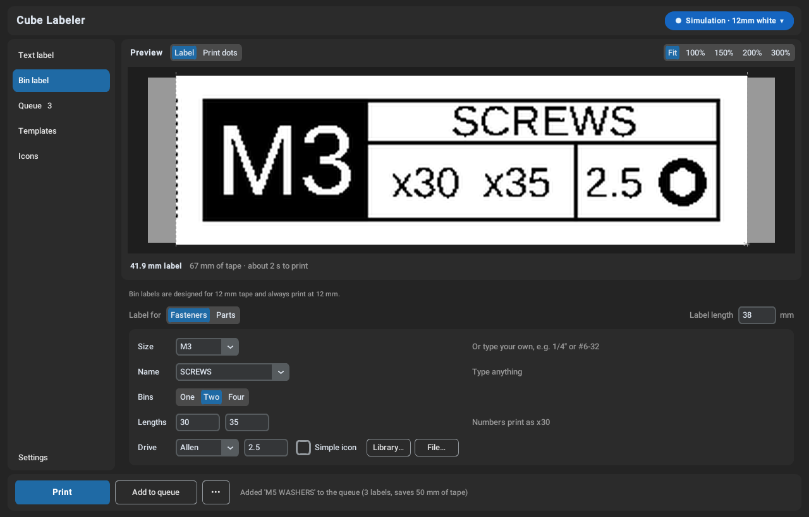
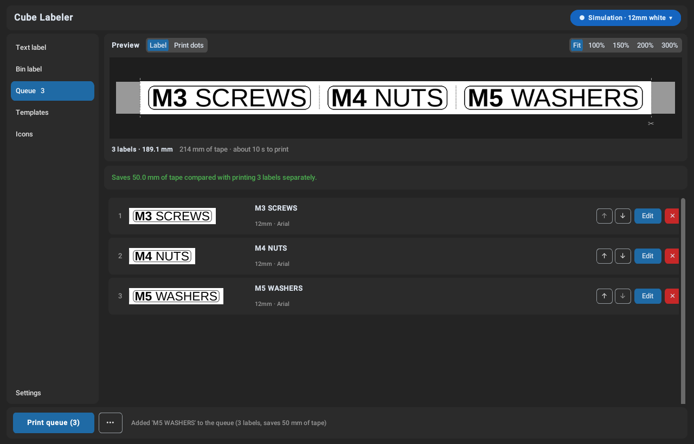
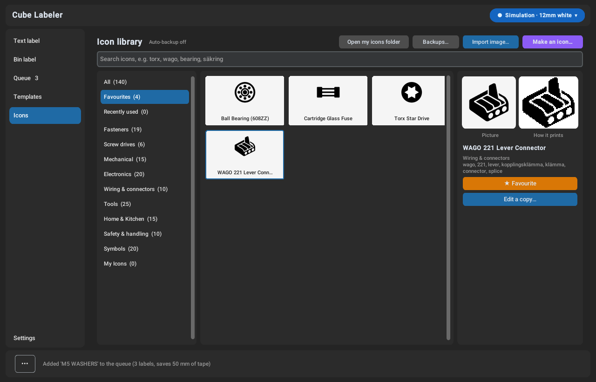
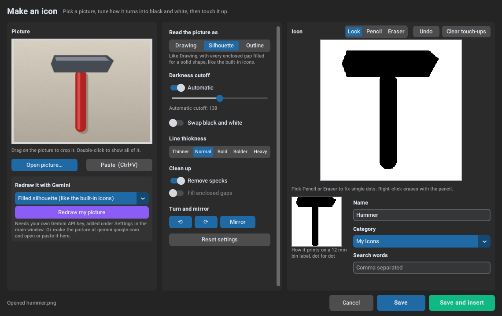
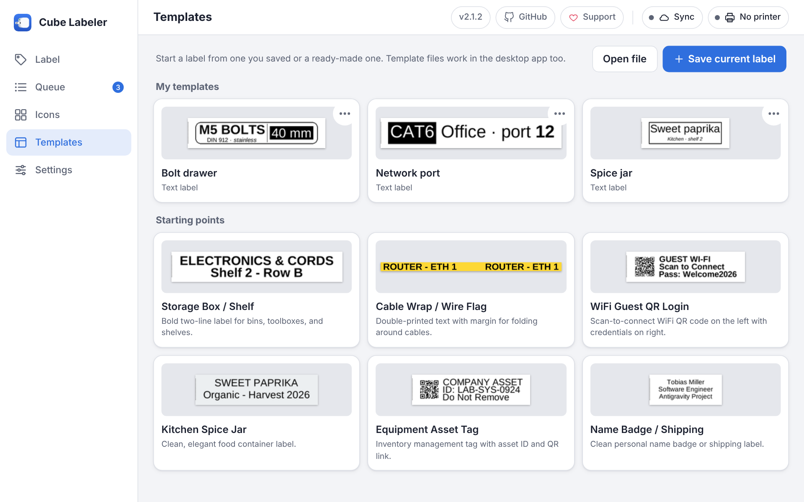
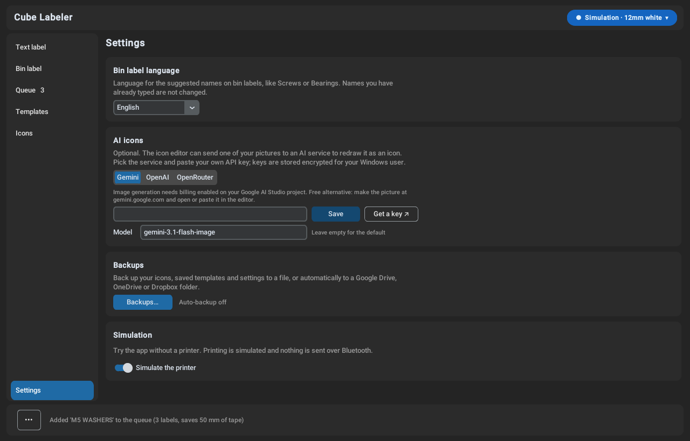

#  Cube Labeler

[](https://github.com/McTobe/cube-labeler/actions/workflows/tests.yml)
[](https://github.com/McTobe/cube-labeler/releases/latest)

[](LICENSE)

A web app for designing and printing labels on the **Brother P-touch Cube (PT-P300BT)** over Bluetooth. Open **<https://print.tobezone.com>** in Chrome or Edge on Android, Windows, macOS or Linux and print straight from the browser, with nothing to install. It shows an exact preview of the printed tape, prints several labels as one strip to save tape, has dedicated editors for storage bins and other common labels, and comes with a library of 140 printable icons that you can add your own to.



## Features

- **Live preview.** See the label on a simulated tape cartridge in its real colors, or switch to *Print dots* to see exactly what the print head will print. Label length, tape used and print time are shown as you type.
- **Less tape waste.** Queue several labels and print them as one continuous strip with cut guides between them. Every label, queued or not, starts with a cut mark (short ticks at the top and bottom edges, so a cut that misses by a little leaves no line down the side) in place of the printer's own ":" cut mark. Each extra label saves about 25 mm of tape.
- **Bin labels.** A dedicated editor for fastener and parts bins: size block, name, one, two or four length boxes and a drive icon (Allen, Hex, PH, PZ, Torx, Slot) for fasteners, or a part icon (bearing, spring, WAGO, terminal block, JST, fuse, resistor, capacitor, LED, or any icon from the library) for parts. Suggested names come in English or Swedish.
- **More kinds of label.** Date labels for the freezer and opened jars (with the use-by date worked out), asset tags, port strips, cable flags, breaker strips and network and power outlets.
- **Text, QR codes, barcodes and images.** About 45 bundled fonts plus any font you add, auto-fit to the tape height or set in millimetres, alignment, vertical text and outline. Mix sizes per line, use bold, italic, underlined or inverted (white on black) text, align single lines, split the label into columns with a divider, and add a box, rounded frame or decorative border. Add QR codes (including Wi-Fi guest login codes), barcodes, icons or your own pictures.
- **Icon library.** Monochrome icons for fasteners, screw drives, mechanical parts, electronics, wiring, tools, home & kitchen and safety marks, plus your own. Browse and manage them on the **Icons** page.
- **Icon editor.** Import or paste any picture and tune how it turns into black and white (drawing, filled silhouette or photo outline, cutoff, line thickness, crop, clean-up) with a live dot-for-dot print preview, then touch it up with a pencil and eraser. Your icons keep their original picture, so you can edit them again later.
- **Backups and Google Drive sync.** Export your icons, templates and settings to one `.cubebackup` file and restore all or part of it on another device, or sync to your own Google Drive, merging changes from each device one by one (the newest 10 backups and one a day for two weeks are kept). API keys are left out.
- **Templates.** Ready-made starting points (storage box, cable flag, Wi-Fi QR, spice jar, asset tag, name badge) and your own templates, saved under **My templates**.
- **Printer status and tape counter.** Battery level, loaded tape width and color, clear messages for errors such as an open cover or missing tape, and how much tape is left on the roll.
- **Print history.** Find and reprint earlier labels.
- **Optional AI icons.** Have Google Gemini, OpenAI or OpenRouter redraw a photo or picture as a printable icon, with ready-made presets or your own instructions, then finish it in the icon editor (needs your own API key for the service, chosen under Settings; it stays in your browser).
- **Works offline and on phones.** After the first visit it also starts offline. On a phone the pages sit behind tabs at the bottom; on a wide screen there is a sidebar, in light and dark.
- **Export.** Save any label as a picture.

## Screenshots

These show a wide screen. On a phone the same pages sit behind tabs at the bottom.

| | |
|---|---|
|  |  |
| **Bin label** with size, two lengths and drive icon | **Queue**: three labels print as one strip and save 50 mm of tape |
|  |  |
| **Icons** page: browse, search, favourite and manage icons | **Icon editor**: turn any picture into a printable icon |
|  |  |
| **Templates**: your own templates as preview cards, plus starting points | **Settings**: printer, label defaults, AI service, backups and Google Drive sync |

## Supported hardware

| | |
|---|---|
| **Printer** | Brother P-touch Cube **PT-P300BT**, connected over Bluetooth |
| **Tape** | Brother TZe tape, 3.5 mm, 6 mm, 9 mm and 12 mm wide. Bin labels use 12 mm tape. |
| **Browser** | Chrome or Edge with Bluetooth on Android, Windows, macOS or Linux. iPhone and iPad can't print, as Safari has no Web Serial. |

Other Brother models are not tested.

## Getting started

1. Turn the printer on and pair it in your phone's or computer's Bluetooth settings.
2. Open <https://print.tobezone.com> in Chrome or Edge.
3. Choose **Connect printer** and pick the printer in the browser's list.

On Android, Chrome also needs the *Nearby devices* permission; after granting it, force stop Chrome and open it again. Labels, icons and settings stay in your browser. The **[web usage guide](docs/web-guide.md)** walks through the rest step by step with pictures: making labels, the kinds of label, the queue, history, the tape counter, sync and using it on a phone. See also [About](https://print.tobezone.com/about.html) and the [privacy policy](https://print.tobezone.com/privacy.html).

### Styling label text

Select text and use the buttons above the editor (**B**, *I*, U, *Inverted*, *Line size*, *Line align*, *Add column*), or type the markers yourself. They are plain text, so templates and the queue keep them.

| Type | Result |
|---|---|
| `**bold**`, `*italic*`, `__underline__`, `==inverted==` | Styles inside a line |
| `[3.5mm] ` at the start of a line | Capital letters 3.5 mm tall |
| `# `, `## `, `-# ` at the start of a line | Large, medium or small line |
| `<< `, `>< `, `>> ` at the start of a line | Left, centred or right line, whatever the label's alignment |
| `---` on its own line | Starts a new column with a divider line |
| `\*` | A plain `*` (works for any marker) |

## Hosting your own

Every release publishes a Docker image, `ghcr.io/mctobe/cube-labeler-web`, that serves the site on port 80. Put it behind a reverse proxy that adds HTTPS, since browsers only allow Bluetooth printing on secure pages. See [docker-compose.yml](docker-compose.yml) and, for Google Drive sync without signing in every hour, [docs/google-sign-in.md](docs/google-sign-in.md). Images are tagged with the version (`2.4.0`, `2.4`) and `latest`; `next` follows main.

## Building from source

You need Python 3.10 or newer, and Node 22 for the web tests.

```bash
git clone https://github.com/McTobe/cube-labeler.git
cd cube-labeler
pip install -r requirements.txt -c constraints.txt
python web/serve.py         # or double-click run_web.bat on Windows
```

`web/serve.py` builds the site into `web/dist/`, serves it and prints the address to open on your phone. See [web/README.md](web/README.md) for how the web side is put together.

Pushing a tag such as `v2.5.0` runs the tests, publishes the GitHub release and builds the Docker image. The version number shown in the app is `APP_VERSION` in `web/js/version.js`.

### Running the tests

```bash
python -m unittest discover tests
python web/build.py && cd web && npm ci && npm test
```

### Updating the guide's screenshots

`tools/screenshots.js` opens the web app in a headless Chrome, fakes a connected printer and takes every picture in [docs/web-guide.md](docs/web-guide.md) again, into `docs/images/guide/`. Run it after a change to the pages it shows:

```bash
python web/build.py
npm install --no-save playwright && npx playwright install chromium   # once
node tools/screenshots.js
```

### Project layout

| Folder | Contents |
|---|---|
| `core/` | The Python label code the web app runs in the browser: printer protocol and status, label and bin label rendering, fonts, icons, templates, backups and config |
| `web/` | The web version: HTML and JavaScript UI, Web Serial printer transport, the Python bridge, build script and Docker setup |
| `assets/` | App icon (`icon.svg`; `python tools/build_app_icon.py` renders `icon.png` and `icon.ico`, needs `pip install resvg-py`), icon library (`assets/icons/catalog.json` lists categories, titles and search words) and template previews |
| `icons-src/` | SVG drawings of the library icons; `python tools/build_icons.py` renders them to `assets/icons/` (needs `pip install resvg-py`) |
| `tests/` | Unit tests for the Python code; the web app's own tests are in `web/tests/` |

## Desktop app (legacy)

Cube Labeler used to have a Windows desktop app as well. It is no longer developed; the last version is 2.4.0. See [docs/desktop.md](docs/desktop.md) for the download and how to use it.

## Support

Cube Labeler is free and open source. If it saves you time, you can [buy me a coffee on Ko-fi](https://ko-fi.com/thetobek) ♥

## Contributing

Bug reports and ideas are welcome in [Issues](https://github.com/McTobe/cube-labeler/issues). See [CONTRIBUTING.md](CONTRIBUTING.md) for how to set up, test and open a pull request, and [SECURITY.md](SECURITY.md) for reporting security problems privately.

## Credits

Cube Labeler started as a GUI for `printlabel` from [Ircama/PT-P300BT](https://github.com/Ircama/PT-P300BT), and its printer protocol code is based on that project. Built with [Pyodide](https://pyodide.org), [Pillow](https://python-pillow.org/), [qrcode](https://github.com/lincolnloop/python-qrcode), [Preact](https://preactjs.com) and [htm](https://github.com/developit/htm). The legacy desktop app also used [customtkinter](https://github.com/TomSchimansky/CustomTkinter) and [pyserial](https://github.com/pyserial/pyserial).

Brother and P-touch are trademarks of Brother Industries, Ltd. This project is not affiliated with or endorsed by Brother.

## License

Cube Labeler is released under the [GNU Affero General Public License v3.0](LICENSE). You can use, change and share it, and if you share a changed version, or run one for other people as a web app, you share its source code under the same license.

The exceptions are `core/ptcbp.py` and `core/ptstatus.py`. Those two files are based on [Ircama/PT-P300BT](https://github.com/Ircama/PT-P300BT), which doesn't state a license, so they are not covered by the AGPL. See [NOTICE.md](NOTICE.md) for details and the third-party parts.
