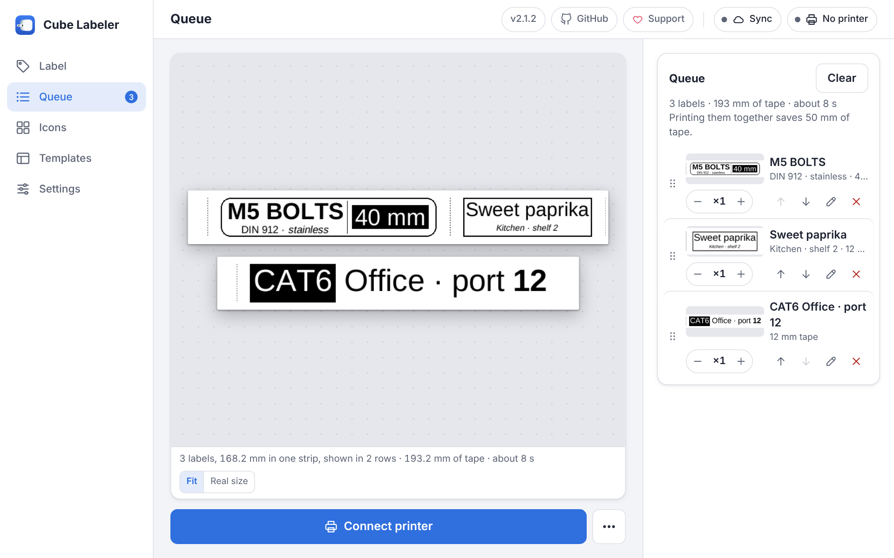
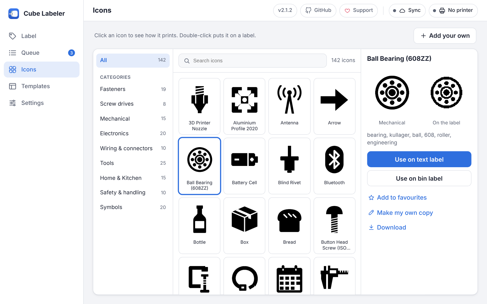
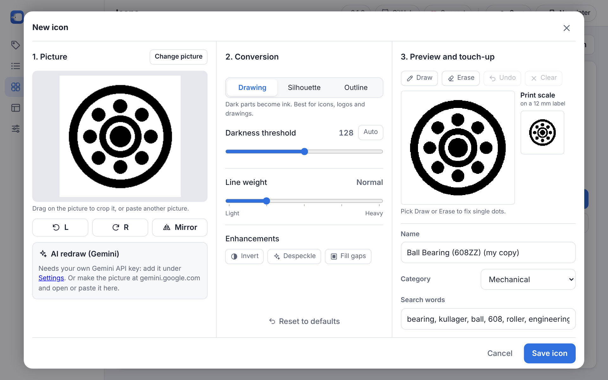
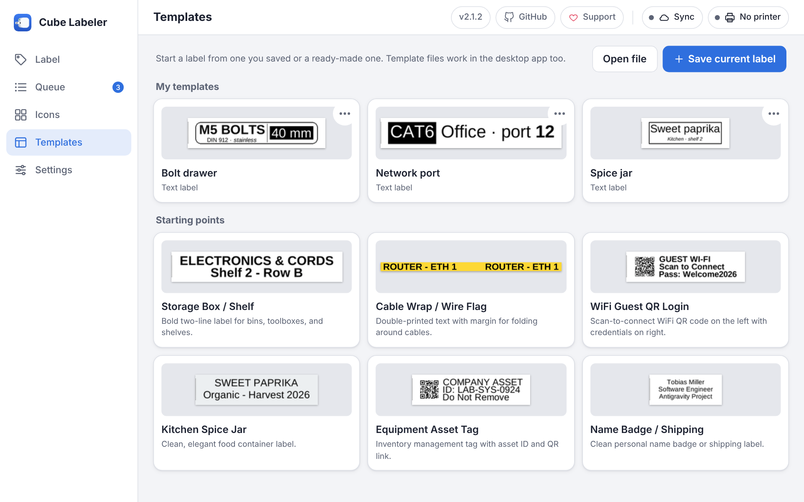
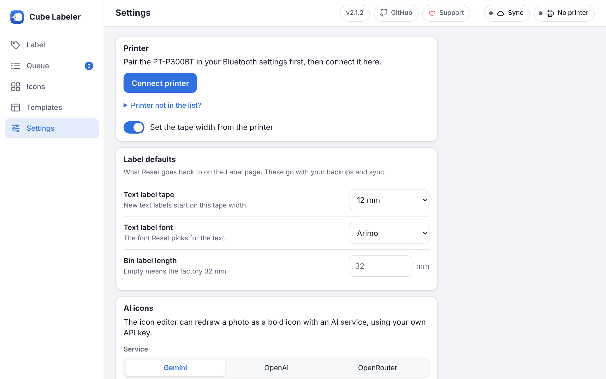
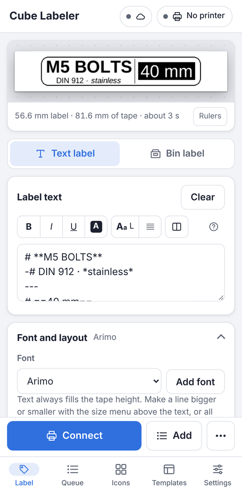

#  Cube Labeler

[](https://github.com/McTobe/cube-labeler/actions/workflows/tests.yml)
[](https://github.com/McTobe/cube-labeler/releases/latest)


[](LICENSE)

An app for designing and printing labels on the **Brother P-touch Cube (PT-P300BT)** over Bluetooth. It shows an exact preview of the printed tape, prints several labels as one strip to save tape, has a dedicated editor for storage bin labels and comes with a library of 140 printable icons that you can add your own to.

Since 2.0 the main way to use it is the [web version](#web-version): open **<https://print.tobezone.com>** in Chrome or Edge on Android, Windows, macOS or Linux and print straight from the browser, with nothing to install. It can back up your icons, templates and settings to your own Google Drive. There is also a Windows desktop app, a single portable `.exe` with a command-line mode for printing from scripts.


## Features

- **Live preview.** See the label on a simulated tape cartridge in its real colors, or switch to *Print dots* to see exactly what the print head will print. Label length, tape used and print time are shown as you type.
- **Less tape waste.** Queue several labels and print them as one continuous strip with cut guides between them. Every label, queued or not, starts with a dotted cut line in place of the printer's own ":" cut mark. Each extra label saves about 25 mm of tape.
- **Bin labels.** A dedicated editor for fastener and parts bins: size block, name, one, two or four length boxes and a drive icon (Allen, Hex, PH, PZ, Torx, Slot) for fasteners, or a part icon (bearing, spring, WAGO, terminal block, JST, fuse, resistor, capacitor, LED, or any icon from the library) for parts. Suggested names come in English or Swedish.
- **Text, QR codes and images.** Any installed or imported font, auto-fit to the tape height, alignment and outline. Mix sizes per line, use bold, italic, underlined or inverted (white on black) text, align single lines, split the label into columns with a divider, and add a box or rounded frame. Add QR codes (including Wi-Fi guest login codes), icons or your own pictures.
- **Icon library.** Monochrome icons for fasteners, screw drives, mechanical parts, electronics, wiring, tools, home & kitchen and safety marks, plus your own icons in `~/.printlabel/icons/`. Browse and manage them on the **Icons** page.
- **Icon editor.** Import or paste any picture and tune how it turns into black and white (drawing, filled silhouette or photo outline, cutoff, line thickness, crop, clean-up) with a live dot-for-dot print preview, then touch it up with a pencil and eraser. Your icons keep their original picture, so you can edit them again later.
- **Backups.** Export your icons, saved templates and settings to one `.cubebackup` file and restore all or part of it on another device; the web version and the desktop app read each other's files. The web version can also sync to your own Google Drive (the newest 3 backups are kept), and the desktop app can back up automatically to a folder that Google Drive, OneDrive or Dropbox syncs (the newest 10 are kept). API keys are left out. Older `.cubeicons` backups still restore.
- **Templates.** Ready-made starting points (storage box, cable flag, Wi-Fi QR, spice jar, asset tag, name badge) and your own templates, saved in the app under **My templates** (template JSON files can still be opened).
- **Printer status.** Battery level, loaded tape width and color, and clear messages for errors such as an open cover or missing tape.
- **Simulation mode.** Design and "print" labels with no printer connected.
- **Optional AI icons.** Have Google Gemini, OpenAI or OpenRouter redraw a photo or picture as a printable icon, with ready-made presets (filled silhouette like the built-in icons, bold line drawing, flat symbol, clean up and keep the shape) or your own instructions, then finish it in the icon editor (needs your own API key for the service, chosen under Settings).
- **Export.** Save any label as a high-resolution PNG.

## Screenshots

These show the web version on a wide screen. On a phone the same pages sit behind tabs at the bottom. The desktop app has the same features in its own window.

| | |
|---|---|
|  |  |
| **Bin label** with size, two lengths and drive icon | **Queue**: three labels print as one strip and save 50 mm of tape |
|  |  |
| **Icons** page: browse, search, favourite and manage icons | **Icon editor**: turn any picture into a printable icon |
|  |  |
| **Templates**: your own templates as preview cards, plus starting points | **Settings**: printer, label defaults, AI service, backups and Google Drive sync |

## Supported hardware

| | |
|---|---|
| **Printer** | Brother P-touch Cube **PT-P300BT**, connected over Bluetooth (serial port) |
| **Tape** | Brother TZe tape, 3.5 mm, 6 mm, 9 mm and 12 mm wide. Bin labels use 12 mm tape. |
| **Computer** | 64-bit Windows 10 or 11 with Bluetooth for the desktop app. The web version needs Chrome or Edge with Bluetooth on Android, Windows, macOS or Linux. |

Other Brother models are not tested. The printing code and the CLI also run on macOS and Linux, but the desktop app is built and tested for Windows.

## Installation

### Web version

Since 2.0 the web version is the main way to use Cube Labeler. It runs the same Python label code in the browser and prints over Bluetooth from Chrome or Edge on Android, Windows, macOS and Linux (iPhone and iPad can't, as Safari has no Web Serial). It has the same features as the desktop app, and can back up to Google Drive.

- **Use it:** open <https://print.tobezone.com>, pair the printer in your phone's or computer's Bluetooth settings and choose **Connect printer**. Labels, icons and settings stay in your browser, and after the first visit it also starts offline. See [About](https://print.tobezone.com/about.html) and the [privacy policy](https://print.tobezone.com/privacy.html).
- **Try it locally:** double-click `run_web.bat` (or run `python web/serve.py`). It opens the page and prints the address to open on your phone.
- **Host your own:** every release publishes a Docker image (`ghcr.io/mctobe/cube-labeler-web`) that serves the site on port 80, behind a reverse proxy that adds HTTPS. See [docker-compose.yml](docker-compose.yml) and, for Google Drive sync without signing in every hour, [docs/google-sign-in.md](docs/google-sign-in.md).



See [web/README.md](web/README.md) for browser setup (Android needs the *Nearby devices* permission for Chrome) and hosting.

### Desktop app (Windows)

1. Download `CubeLabeler.exe` from the [latest release](https://github.com/McTobe/cube-labeler/releases/latest).
2. Put it anywhere you like and double-click it. There is nothing to install.

Windows SmartScreen may warn you the first time because the file is not code-signed. Choose **More info**, then **Run anyway**.

## Connecting the printer (desktop app)

In the web version, choose **Connect printer** and pick the printer in the browser's list. For the desktop app:


1. Turn the printer on. The power LED turns green.
2. In Windows, open **Settings → Bluetooth & devices → Add device**, choose **Bluetooth** and pick **PT-P300BT**. Windows creates a serial (COM) port for it.
3. In Cube Labeler, click the **printer chip** at the top right. Turn **Simulation** off, choose **Scan ports** and select the printer's port (for example `COM3`).
4. Choose **Check status**. The chip shows the model, loaded tape and battery when the printer is ready.

## Usage

This section describes the desktop app; the web version works the same way, with its pages in a sidebar or, on a phone, in tabs.

The window has a **left rail** for switching views, the **tape preview** in the middle and the **printer chip** at the top right.

| View | What it's for |
|---|---|
| **Text label** | Type text under the preview. Font, QR code, icon, length and advanced options are in the panel on the right. |
| **Bin label** | Labels for fastener or parts bins. Pick *Fasteners* or *Parts* under *Label for*; fields are listed in the order they appear on the label. |
| **Queue** | Labels added with **Add to queue** print as one strip. Reorder, edit or remove them before printing. |
| **Templates** | Ready-made labels and your own saved templates. |
| **Icons** | The icon library: browse, search, import, make, edit and back up icons. |
| **Settings** | Bin label language, AI service (Gemini, OpenAI or OpenRouter) with its API key and model, backups and simulation mode. |

### Styling label text

Select text and use the buttons above the editor (**B**, *I*, U, *Inverted*, *Line size*, *Line align*, *Add column*), or type the markers yourself. They are plain text, so templates, the queue and the web version keep them.

| Type | Result |
|---|---|
| `**bold**`, `*italic*`, `__underline__`, `==inverted==` | Styles inside a line (`Ctrl+B`, `Ctrl+I`, `Ctrl+U`) |
| `# `, `## `, `-# ` at the start of a line | Large, medium or small line |
| `<< `, `>< `, `>> ` at the start of a line | Left, centred or right line, whatever the label's alignment |
| `---` on its own line | Starts a new column with a divider line |
| `\*` | A plain `*` (works for any marker) |

Fonts without their own bold or italic file get a drawn one. The **Frame** option in the *Text* section puts a box or rounded frame around the label.

The preview can show the whole label (**Fit**) or zoom to 100–300%, where long labels scroll sideways. The **•••** menu next to **Print** has *Export PNG* and *Feed tape*.

### Keyboard shortcuts

| Shortcut | Action |
|---|---|
| `Ctrl+P` | Print |
| `Ctrl+Enter` | Add to queue |
| `Ctrl+S` | Export PNG |
| `Ctrl+B`, `Ctrl+I`, `Ctrl+U` | Bold, italic, underline in the label text |
| `Esc` | Close the printer panel |

### Command line

Run `CubeLabeler.exe` with arguments to use it without the window:

```powershell
CubeLabeler.exe --ports                       # list serial ports and find the printer
CubeLabeler.exe COM4 --status                 # battery, tape and errors
CubeLabeler.exe COM4 "Storage Box #42"        # print a label
CubeLabeler.exe COM4 "Line one\nLine two"     # two-line label
CubeLabeler.exe COM4 --feed                   # feed 25 mm of tape
CubeLabeler.exe --virtual "Test" --preview --save-png test.png  # no printer needed
```

`CubeLabeler.exe --help` lists every option, including `--font`, `--font-size`, `--width`, `--image`, `--no-cut-guide` and `--auto-cut`.

## Building from source

You need Python 3.10 or newer (releases are built with 3.11).

```powershell
git clone https://github.com/McTobe/cube-labeler.git
cd cube-labeler
pip install -r requirements.txt -c constraints.txt
python main.py          # or double-click run.bat
```

To build the portable executable, install PyInstaller and run the build script. The result is `dist\CubeLabeler.exe`.

```powershell
pip install pyinstaller -c constraints.txt
python build.py         # or double-click build.bat
```

Pushing a tag such as `v2.1.2` builds the executable on GitHub Actions and publishes it as a release, and builds and publishes the web version's Docker image. The version number shown in the app is `APP_VERSION` in `web/js/version.js`.

### Running the tests

```bash
python -m unittest discover tests
```

The tests run on Windows and Linux in CI. On machines without tkinter the GUI tests are skipped.

### Project layout

| Folder | Contents |
|---|---|
| `core/` | Printer protocol and status, serial driver and simulator, label and bin label rendering, fonts, icons, config, CLI |
| `ui/` | The customtkinter app: main window, preview, editors, printer chip, templates, settings, dialogs |
| `web/` | The web version: HTML and JavaScript UI, Web Serial printer transport, the Python bridge, build script and Docker setup |
| `assets/` | App icon (`icon.svg`; `python tools/build_app_icon.py` renders `icon.png` and `icon.ico`, needs `pip install resvg-py`), icon library (`assets/icons/catalog.json` lists categories, titles and search words) and template previews |
| `icons-src/` | SVG drawings of the library icons; `python tools/build_icons.py` renders them to `assets/icons/` (needs `pip install resvg-py`) |
| `tests/` | Unit tests and headless GUI tests |

## Support

Cube Labeler is free and open source. If it saves you time, you can [buy me a coffee on Ko-fi](https://ko-fi.com/thetobek) ♥

## Contributing

Bug reports and ideas are welcome in [Issues](https://github.com/McTobe/cube-labeler/issues). See [CONTRIBUTING.md](CONTRIBUTING.md) for how to set up, test and open a pull request, and [SECURITY.md](SECURITY.md) for reporting security problems privately.

## Credits

Cube Labeler started as a GUI for `printlabel` from [Ircama/PT-P300BT](https://github.com/Ircama/PT-P300BT), and its printer protocol code is based on that project. Built with [customtkinter](https://github.com/TomSchimansky/CustomTkinter), [Pillow](https://python-pillow.org/), [pyserial](https://github.com/pyserial/pyserial) and [qrcode](https://github.com/lincolnloop/python-qrcode); the web version also uses [Pyodide](https://pyodide.org), [Preact](https://preactjs.com) and [htm](https://github.com/developit/htm).

Brother and P-touch are trademarks of Brother Industries, Ltd. This project is not affiliated with or endorsed by Brother.

## License

Cube Labeler is released under the [GNU Affero General Public License v3.0](LICENSE). You can use, change and share it, and if you share a changed version, or run one for other people as a web app, you share its source code under the same license.

The exceptions are `core/ptcbp.py` and `core/ptstatus.py`. Those two files are based on [Ircama/PT-P300BT](https://github.com/Ircama/PT-P300BT), which doesn't state a license, so they are not covered by the AGPL. See [NOTICE.md](NOTICE.md) for details and the third-party parts.
