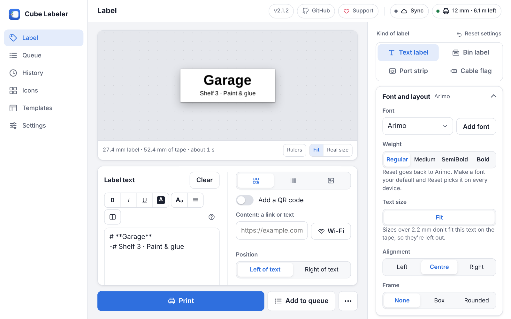
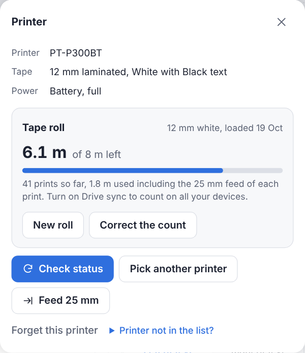
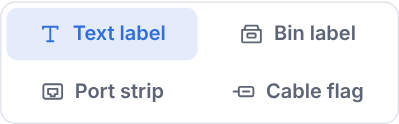
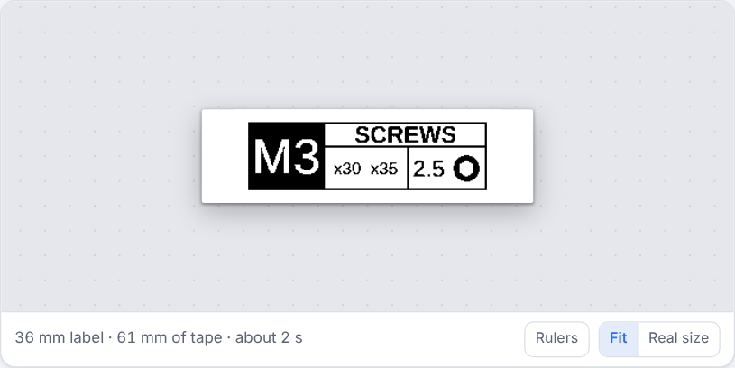
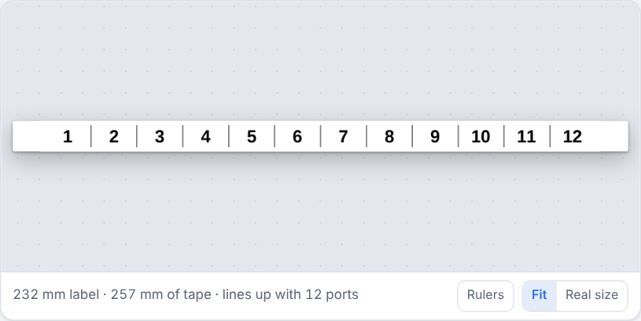
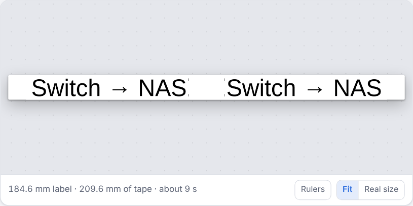
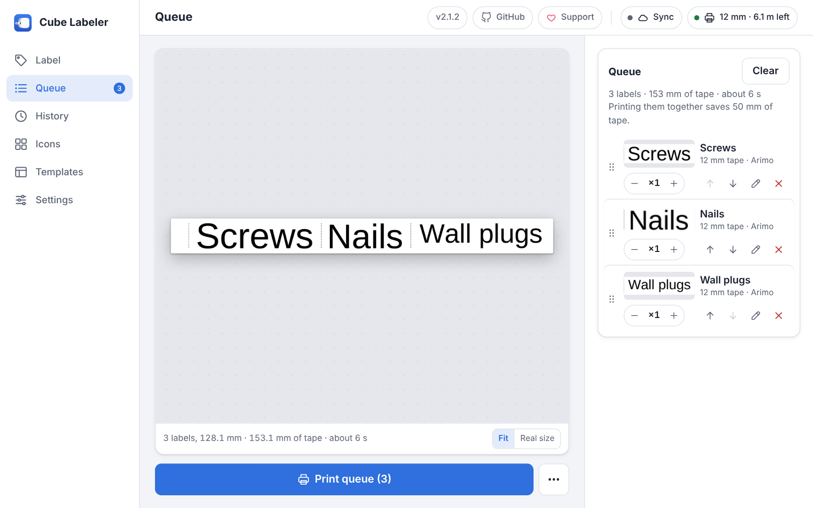
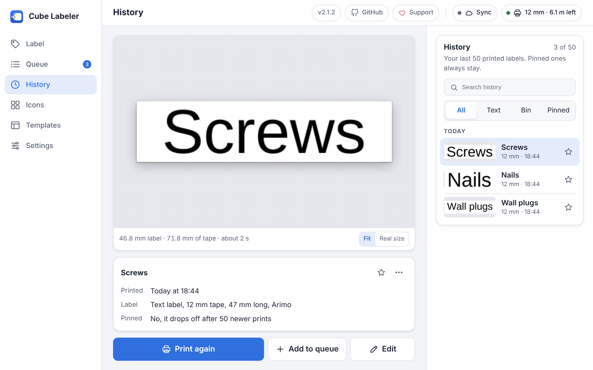
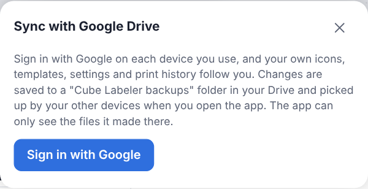
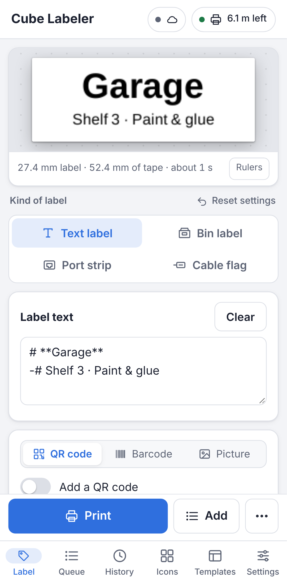

# Using Cube Labeler

This guide covers the web version at **<https://print.tobezone.com>**. The Windows desktop app has the same pages in its own window.

## What you need

- A Brother P-touch Cube **PT-P300BT** with TZe tape (3.5, 6, 9 or 12 mm).
- **Chrome or Edge** on Android, Windows, macOS or Linux. Firefox, Safari, iPhone and iPad can design labels and save them as pictures, but can't print, because they have no Web Serial.

There is nothing to install and no account. Your labels, icons and settings stay in the browser on your device. After the first visit the app also starts without internet.

## 1. Connect the printer

1. Turn the printer on and pair **PT-P300BT** in your phone's or computer's Bluetooth settings.
2. Open the app and choose the **printer chip** at the top right (it says *No printer*).
3. Choose **Connect printer** and pick the printer in the browser's list.

The chip then shows the tape width and how much tape is left. Choose it again any time to see the printer, tape and battery, feed 25 mm of tape, or check the status.

> **Printer not in the list on Android?** Chrome needs the *Nearby devices* permission (Settings › Apps › Chrome › Permissions). After allowing it, force stop Chrome and open it again.

## 2. Make a label

Type in **Label text** and the preview shows the label on the tape, with its length, the tape it uses and the print time underneath. Then choose **Print**, or **Add to queue** to print it later together with others.

- **Font and layout** on the right sets the font, weight, text size, alignment and a frame.
- The tabs next to the text add a **QR code**, a **Barcode** or a **Picture**. Under the QR code content, **Wi-Fi**, **Contact**, **Email** and **More** (phone call, location, text message, WhatsApp, calendar event, social profile) fill it in for you, and a dot says whether the code will scan at this tape width.
- **Fit** shows the whole label; **Real size** shows it at its printed size.

### Styling text

Select text and use the buttons above the editor, or type the markers yourself:

| Type | Result |
|---|---|
| `**bold**`, `*italic*`, `__underline__`, `==inverted==` | Bold, italic, underlined, or white on black |
| `# `, `## `, `-# ` at the start of a line | Large, medium or small line |
| `<< `, `>< `, `>> ` at the start of a line | Left, centred or right line |
| `---` on its own line | A new column with a divider line |

The text box shows the styles as you type: bold, italic, underlined and inverted words look that way,
and the markers turn pale grey. Sizes and alignment only show on the label. The buttons light up for
the style under the cursor, and **\*\*** at the end of the toolbar switches the box to the plain
markers and back. The **?** next to **Clear** explains the markers.

## 3. Pick the kind of label

**Kind of label** at the top right switches between four editors.

| Kind | What it's for |
|---|---|
|  | **Bin label.** For drawers of screws, nuts and parts on 12 mm tape. Pick the size, name, lengths and drive or part icon. *Add to queue and start the next* keeps what stays the same, for filling a whole drawer. |
|  | **Port strip.** One strip that lines up with the ports on a patch panel or switch: numbers or names, 6 to 24 ports, with the spacing measured for you. |
|  | **Cable flag.** The text printed twice with a gap that wraps round the cable, so the flag reads from both sides. Pick the cable thickness. |

## 4. Print several labels as one strip

Every label you add to the queue prints in one go, with cut lines between them. Each extra label saves about 25 mm of tape. On the **Queue** page you can set copies, reorder, edit or remove labels before you choose **Print queue**.

If the queue needs more tape than is left on the roll, or more than the printer's 499 mm per print, it prints in parts, split at cut lines, and asks for a new roll when one is needed.

## 5. Print a label again

The **History** page keeps your last 50 printed labels (or 20 or 200, under Settings). Search them, filter by kind, and choose **Print again**, **Add to queue** or **Edit**. Star a label to pin it so it always stays.

## 6. Keep track of tape

In the printer panel, choose **Set tape roll** and say which roll is in the printer (8 m, 4 m or another length). The chip then counts down as you print, including the 25 mm feed of each print, and turns amber under 30 cm. Choose **New roll** when you change it, or **Correct the count** if it is off.

## 7. Your own icons and templates

- **Icons** holds 140 printable icons. Import or paste a picture to make your own, and tune it in the icon editor.
- **Templates** has ready-made starting points. **Save current label** on the Templates page keeps the label you're working on as your own template.

## 8. Sync and backups

Choose **Sync** at the top and **Sign in with Google** on each device you use. Your icons, templates, settings, print history and tape count then follow you between devices, through a *Cube Labeler backups* folder in your own Google Drive. The app can only see the files it made there.

Without Google, **Settings › Backups and sync** can save everything to one `.cubebackup` file, or to a folder on your computer every time something changes.

## 9. On a phone

The same pages sit in tabs at the bottom, and **Print** and **Add** stay in reach above them. The styling buttons show up while you type, docked on top of the keyboard with **Print** and **Add** under them, so a label prints without closing the keyboard. In Chrome's menu, **Add to Home screen** gives the app its own icon and window.

## Keyboard shortcuts

| Shortcut | Action |
|---|---|
| `Ctrl+P` | Print |
| `Ctrl+Enter` | Add to queue |
| `Ctrl+B`, `Ctrl+I`, `Ctrl+U` | Bold, italic, underline in the label text |
